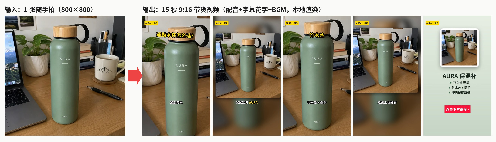
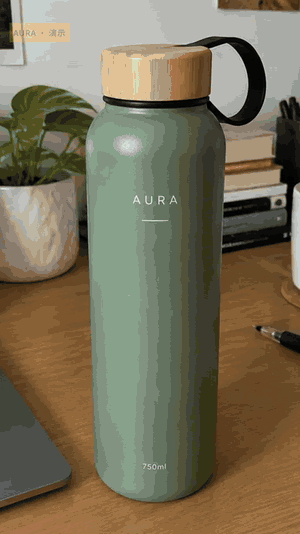
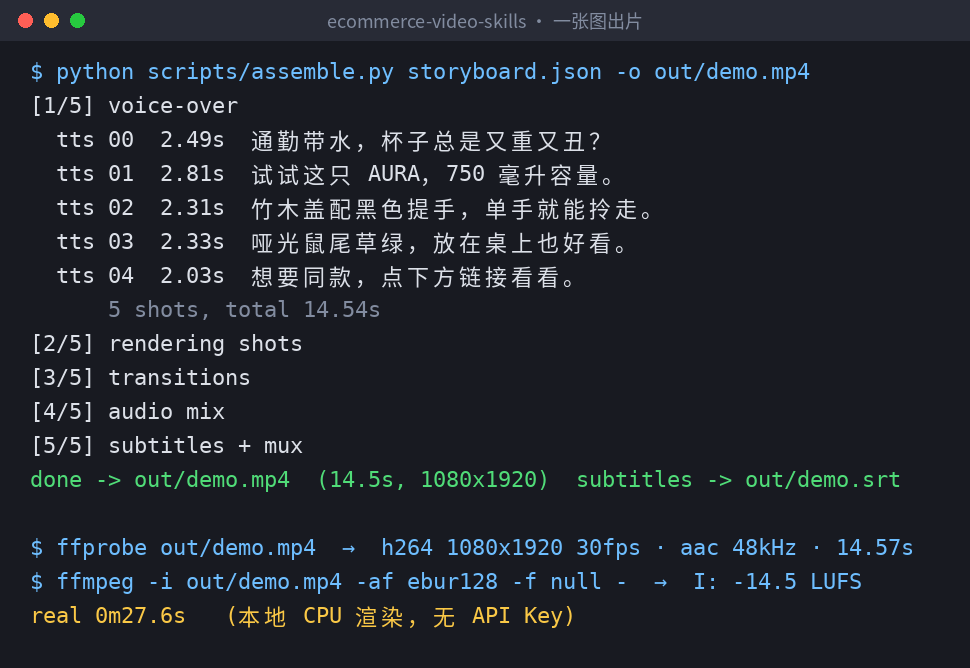
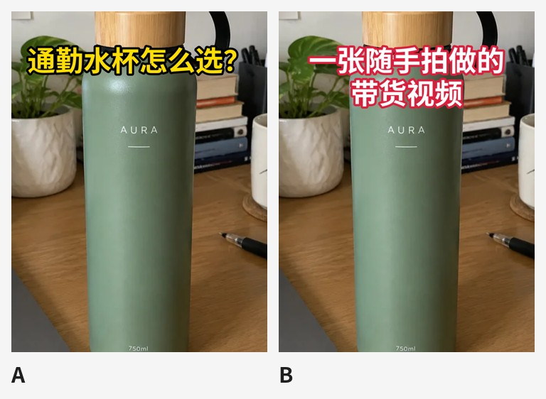

> 在线阅读（GitHub Pages）：https://maynor996.github.io/claude-code-douyin-video/

# 只用 1 张随手拍，在 Claude Code 里做出 15 秒抖音带货视频（配音 + 字幕花字 + BGM，本地出片）

> 项目地址：**[xianyu110/ecommerce-video-skills](<https://github.com/xianyu110/ecommerce-video-skills?utm_source=csdn&utm_medium=article&utm_campaign=ecommerce-video-skills&utm_content=top>)** （MIT，12 个电商短视频 Agent Skills）
> 
> 本文所有成片、截图都是在一台普通 Linux 机器上用仓库脚本实测跑出来的，命令可以直接复制。

先看结果。左边是输入，一张 800×800 的桌面随手拍；右边是输出，一条 14.5 秒的 9:16 竖屏带货视频：

动图预览（GIF 压缩过，原片是 1080×1920 / 30fps，[点这里下载 MP4](<

整条视频里只有一张素材图：开场的推近、中段的模糊背景加小画面、顶部竹木盖的下移镜头，都是同一张图用不同的 `motion` / `fit` 参数做出来的；结尾卡也是脚本用这张图自动排的版。

### 一、为什么要用「Skill」做带货视频

让大模型写带货脚本不难，难在后面那几步：

  1. **它写完分镜，你还得自己开剪映一镜一镜拖** ；
  2. 配音和字幕要对齐，改一句台词就得重新对一遍时间轴；
  3. 抖音 9:16、小红书 3:4、淘宝主图视频 1:1，每个平台再导一遍；
  4. 口播里一不小心就写出「最」「第一」「100%」这类广告法风险词。

`ecommerce-video-skills` 的做法是把这条流水线拆成 12 个 Agent Skill（一个文件夹一个 `SKILL.md`，可选附带脚本），其中「剪辑」这一步交给仓库里的 Python + ffmpeg 脚本真正执行。agent 负责「想」（钩子、分镜、台词），脚本负责「做」（配音、镜头、字幕、混音、导出）。

### 二、安装（2 分钟）
    
    
    # 方式一：skills CLI 一行装
    npx skills add xianyu110/ecommerce-video-skills
    
    # 方式二：Claude Code 插件市场
    /plugin marketplace add xianyu110/ecommerce-video-skills
    
    # 方式三：手动复制（Codex / Cursor 同理）
    git clone https://github.com/xianyu110/ecommerce-video-skills.git && cd ecommerce-video-skills
    mkdir -p ~/.claude/skills && cp -r skills/* ~/.claude/skills/   # Claude Code
    mkdir -p ~/.codex/skills  && cp -r skills/* ~/.codex/skills/    # Codex
    pip install -r requirements.txt   # pillow / numpy / edge-tts；另需 ffmpeg（带 libass）和中文字体
    

每个 skill 文件夹自带它需要的脚本，互不依赖，只复制用得到的也行。

### 三、Step 1：让 agent 写 3 秒钩子

在 Claude Code 或 Codex 里直接说：
    
    
    用 hook-3s-script 给这个保温杯写 8 个前三秒开场，标出推荐 Top 3。
    真实卖点只有：750ml、竹木盖带提手、哑光鼠尾草绿。
    

`hook-3s-script` 里写死了几条规则，agent 会照着执行：

  * 9 种钩子类型（痛点提问、反差、结果先行、数字、场景代入、错误示范、对比、第一人称、悬念），每条用不同类型，方便 A/B；
  * 每条 **≤18 个汉字** （中文语速约 4–5 字/秒，3 秒说完），花字 ≤10 字；
  * 第一帧必须是商品或痛点画面，不放 logo 片头；
  * 禁用「最、第一、顶级、国家级、100%、根治」等绝对化用语，**只能用你确认过的卖点** 。

我这里只给了 3 个能从照片上直接看到的卖点（瓶身印着 750ml、竹木盖、提手、颜色），所以后面的口播里没有任何「保冷 24 小时」之类没测过的说法。最后选的开场是痛点提问型：「通勤带水，杯子总是又重又丑？」

### 四、Step 2：15 秒分镜 → storyboard.json

接着说：
    
    
    用 selling-point-storyboard 按 ./assets/photo.webp 做一条 15 秒抖音分镜，只有这一张图，输出 storyboard.json
    

skill 里的 15 秒结构是：**钩子(1) → 产品亮相(1) → 卖点×2–3 → 行动号召(1)，共 5–6 镜** ，并且要求「一镜一信息」、总台词字数 ≈ 时长 × 4.5。素材只有一张图时，skill 给的办法是「同一张图用不同 motion / fit 做两镜」。按这个模板整理出来的分镜如下（完整文件就是本文附带的 `storyboard.json`）：
    
    
    {
      "voice": "zh-CN-YunxiNeural", "rate": "+12%", "bgm": "auto", "tag": "AURA · 演示",
      "shots": [
        {"image": "assets/photo.webp", "fit": "cover", "motion": "punch", "transition": "slideup",
         "line": "通勤带水，杯子总是又重又丑？", "sub": "通勤带水|杯子又**重**又丑？", "title": "通勤水杯怎么选？"},
        {"image": "assets/photo.webp", "fit": "blur", "motion": "zoom_in", "transition": "fade",
         "line": "试试这只 AURA，750 毫升容量。", "sub": "试试这只 **AURA**|750ml 容量"},
        {"image": "assets/photo.webp", "fit": "cover", "motion": "pan_down", "transition": "slideleft",
         "line": "竹木盖配黑色提手，单手就能拎走。", "sub": "竹木盖 + 提手|**单手就能拎走**", "title": "竹木盖"},
        {"image": "assets/photo.webp", "fit": "blur", "motion": "zoom_out", "transition": "fade",
         "line": "哑光鼠尾草绿，放在桌上也好看。", "sub": "哑光**鼠尾草绿**|放桌上也好看"},
        {"image": "assets/end-card.png", "motion": "zoom_in", "min": 3.0,
         "line": "想要同款，点下方链接看看。", "sub": "", "cta": "点击下方链接 ›"}
      ]
    }
    

几个字段说明一下：

字段| 作用  
---|---  
`line`| 配音文本。镜头时长 = 配音时长 + 0.15s 前导 + 留白，**不用手动对时间轴**  
`sub`| 字幕；`**词**` 是关键词高亮（黄色），`|` 是分行；`""` 表示这镜不出字幕  
`title` / `cta`| 弹出花字 / 底部行动号召按钮  
`motion`| `punch`（0.35 秒快速推近，开场钩子专用）、`zoom_in`、`zoom_out`、`pan_*`、`static`  
`fit`| `cover` 裁满；`blur` 模糊背景 + 完整画面（方图放进竖屏时避免裁掉商品）  
  
结尾卡用仓库里的 `make_cards.py` 生成，文字是 PIL 本地渲染，中文不会糊：
    
    
    python scripts/make_cards.py --image assets/photo.webp --name "AURA 保温杯" \
      --points "750ml 容量|竹木盖 + 提手|哑光鼠尾草绿" -o assets/end-card.png
    

### 五、Step 3：一条命令出片
    
    
    python scripts/assemble.py storyboard.json -o out/demo.mp4
    

脚本分 5 步走：edge-tts 逐句配音 → 每镜 Ken Burns 渲染 → xfade 转场 → 配音 + BGM 混音 → 字幕烧录并封装。我这台机器上总共 27.6 秒跑完。用 ffprobe 和 ebur128 复查成片：

  * H.264 1080×1920，30fps；AAC 48kHz；时长 14.57 秒
  * 整体响度 **-14.5 LUFS** （脚本做了两遍 loudnorm，目标约 -14 LUFS）
  * 同时输出 `out/demo.srt`，8 条字幕，可以单独上传给平台

几个实现细节，是我觉得这个仓库比「提示词合集」靠谱的地方：

  * **Ken Burns 用逐帧 scale + crop** ，比 ffmpeg 自带的 zoompan 抖动小；
  * **转场不吃配音** ：每镜多渲染半个转场长度，配音按镜头起点对齐；
  * **BGM 自动闪避** ：`bgm: "auto"` 是 `make_bgm.py` 实时合成的免版权音乐，有人声时再压 10dB；
  * 想先看节奏不等配音，可以 `--tts none` 按字数估时离线预览。

抽 6 帧看一下（左上角黄色贴纸是 `tag` 字段，提醒这是演示素材）：

### 六、Step 4：一键导出抖音 / 小红书 / 淘宝三个规格
    
    
    python scripts/export_platform.py out/demo.mp4 --platform douyin xiaohongshu taobao-main
    python scripts/export_platform.py out/demo.mp4 --safe-preview out/safe.png
    

实测输出：

平台| 分辨率| 大小  
---|---|---  
douyin| 1080×1920| 4.36 MB  
xiaohongshu| 1080×1440（3:4）| 3.37 MB  
taobao-main| 1080×1080（1:1）| 2.59 MB  
  
比例不同时默认模糊填充（`--mode blur`），也可以 `--mode crop` 裁切。`--safe-preview` 会在一帧上叠出容易被遮挡的区域（顶部状态栏、右侧按钮、底部文案/商品卡），用来检查字幕有没有压到 UI——这是经验值，脚本自己也提示最终以真机为准：

### 七、Step 5：封面 A/B
    
    
    python scripts/cover_ab.py out/demo.mp4 --images build/still00.png build/still02.png \
      --titles "通勤水杯怎么选？|一张随手拍做的带货视频"
    

`--images` 用的是渲染过程中留下的干净底图（不带字幕），新标题叠上去不会和原字幕打架：

### 八、踩坑与建议

  1. **第一次生成的结尾卡有两个按钮** ：我一开始给 `make_cards.py` 也传了 `--cta`，和 storyboard 里的 `cta` 叠在一起。去掉其中一个即可——这也说明渲染完一定要抽帧看一眼（skill 的检查清单里就有这一步）。
  2. **只有一张图时** ，开场用 `fit: cover` \+ `punch` 做冲击，中间穿插 `fit: blur` 的完整画面，节奏不会单调。
  3. **卖点只写能证明的** 。照片能看到的就能说；保温时长这类数据，没测过就别进口播。
  4. 有真实视频模型（Seedance / 可灵 / Veo / Runway / 海螺 / 万相…）时，用 `image-to-video-shots` / `multi-model-shot-prompts` 出镜头提示词，生成的片段用 `video` \+ `start` 字段替换图片；没生成好的镜头，Ken Burns 兜底照样能出片。
  5. 做出海：每镜加 `line_en / sub_en`，`--lang en --voice en-US-AndrewNeural` 就能渲染英文版；`multilingual-dubbing` 里还列了印尼、泰国、越南、日韩、墨西哥、巴西等市场的 edge-tts 音色。

### 九、12 个 Skill 一览

Skill| 做什么  
---|---  
hook-3s-script| 3 秒钩子，9 种类型，一次 6–10 版，广告法自检  
selling-point-storyboard| 15/30/60 秒分镜，直接输出 storyboard.json  
image-to-video-shots| 商品图 → 图生视频镜头提示词 + 商品一致性锁 + 本地兜底  
multi-model-shot-prompts| 同一份分镜适配不同视频模型，不编造价格/参数  
ai-voiceover-edge-tts| edge-tts 逐句配音、去静音、缓存  
subtitles-and-text-effects| ASS 字幕 / 花字 / 贴纸 / CTA 四种样式 + 安全区  
ffmpeg-auto-assemble| 一条命令出片  
platform-spec-export| 抖音 / TikTok Shop / 视频号 / 小红书 / 淘宝 / Amazon 规格导出  
live-stream-clips| 直播录像切 9:16 高光  
unboxing-comparison-review| 开箱 / 对比评测模板 + 公平对比规则  
multilingual-dubbing| 多语言本地化配音  
cover-title-ab| 封面与标题 A/B  
  
### 十、写在最后

这套 skill 解决的是带货视频里「重复、确定」的那部分：分镜写成 JSON，剪辑交给 ffmpeg，规格和安全区交给脚本。卖点真不真、成片好不好看，还是要人来把关。

演示商品「AURA」是 AI 生成的虚构商品（素材来自姊妹仓库 [ecommerce-image-skills](<https://github.com/xianyu110/ecommerce-image-skills?utm_source=csdn&utm_medium=article&utm_campaign=ecommerce-video-skills&utm_content=sister-repo>)），配音为 edge-tts 合成。平台规格经常变化，上传前以各平台后台说明为准。

觉得有用的话，欢迎去点个 ⭐：

👉 **https://github.com/xianyu110/ecommerce-video-skills?utm_source=csdn &utm_medium=article&utm_campaign=ecommerce-video-skills&utm_content=footer**

商品图还没做？可以先用 [gptimage2.asia](<https://gptimage2.asia/?utm_source=csdn&utm_medium=article&utm_campaign=ecommerce-video-skills&utm_content=footer-image>) 在线生成主图和场景图，再交给本仓库转成视频。